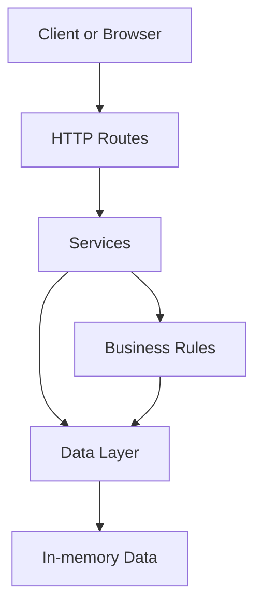
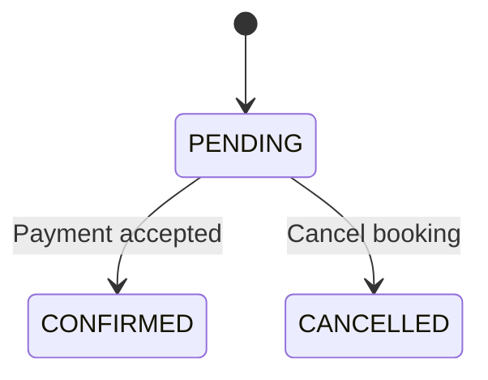

# Build 3: Architecture and Booking State Machine

## 1. Architecture diagram

## 2. Layer responsibilities

- **Routes:** Receive HTTP requests and return HTTP responses.
- **Services:** Coordinate application operations, such as booking and cancellation.
- **Rules:** Enforce business rules, including valid booking state transitions.
- **Data:** Store and retrieve events, ticket tiers, and bookings. The initial version may use in-memory data.

## 3. Booking state machine

## 4. Booking transition rules

| Current state | Next state | Allowed |
|---|---|---|
| PENDING | CONFIRMED | Yes |
| PENDING | CANCELLED | Yes |
| CANCELLED | CONFIRMED | No |
| CONFIRMED | CANCELLED | No |
| CONFIRMED | CONFIRMED | No |

CONFIRMED and CANCELLED are terminal states in this initial model. Any transition not explicitly allowed must be rejected.

## 5. Health endpoint

The HTTP server will provide:

- `GET /health` — returns an HTTP 200 response when the server is running.
- Other paths — serve available static files or return an appropriate not-found response.
